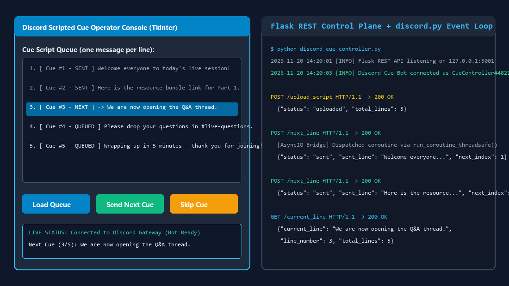

# Discord Scripted Cue Controller & REST API Bridge



A hybrid `discord.py` + `Flask` REST API + `Tkinter` operator console that lets live event moderators or operators queue multi-line scripts and trigger, preview, or skip automated Discord messages in real time.

## Technical Architecture
- **Thread-Safe Async Bridge:** Uses `asyncio.run_coroutine_threadsafe` to safely schedule Discord coroutine message dispatches from Flask HTTP worker threads into the `discord.py` event loop.
- **REST Control Plane:** Exposes `/upload_script`, `/current_line`, `/next_line`, and `/skip_line` JSON endpoints.
- **Desktop Operator GUI:** Built-in `Tkinter` control panel for pasting script queues and stepping through cues live.

## Quick Start
```bash
pip install discord.py flask python-dotenv requests
cp .env.example .env
# Add DISCORD_BOT_TOKEN and DISCORD_TARGET_USER_ID in .env
python discord_cue_controller.py
```
